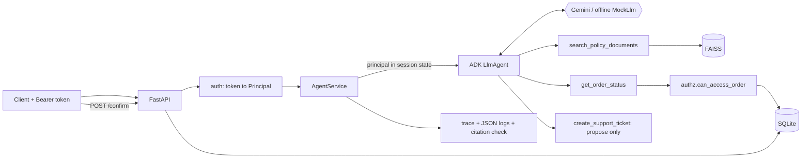

# Enterprise AgentOps

An enterprise employee assistant built on **Google Agent Development Kit (ADK)** and the **Gemini API**.
It answers policy questions with RAG over internal documents, looks up orders through **authorized tools**,
and proposes support tickets that need **explicit human confirmation**. The focus is not the chatbot; it is
what surrounds it: backend-enforced authorization, prompt-injection resistance, evaluation, and observability.

> **Scope and honesty.** This is a portfolio project on **synthetic data**. It is not production-ready, has
> not been deployed anywhere, and makes no Gemini Enterprise claim. See [What was and wasn't verified](#what-was-and-wasnt-verified).

## The core journey

An authenticated employee asks: *"Can order ORD-1001 be refunded, and what is its current delivery status?"*
The service (real output from the offline mode, `scripts/demo.py`):

```
A: Order ORD-1001 (Noise-cancelling headphones) is delivered; delivered 2026-10-24 (10 days ago) via BlueDart (order record).
   Refund: eligible, it is within the 30-day window from delivery (POL-001 §1. Eligibility window).
sources: ['POL-001 §1. Eligibility window', 'POL-001 §4. Refund method and timing', 'POL-001 §6. How to request']
  model asked for tool: get_order_status
  authz   order=ORD-1001 allowed=True reason='order owner'
  model asked for tool: search_policy_documents
  retrieve POL-001#1(0.5419), POL-001#4(0.291), POL-004#4(0.2469), POL-001#6(0.2202)
```

1. The agent looks up the order, and the **backend** checks that the authenticated user may see it.
2. It retrieves the applicable refund-policy section (FAISS).
3. It combines both and answers with source references; every cited section is checked against what was actually retrieved.
4. The request, retrieval, tool calls, authorization decisions, latency, and errors are all in a trace (`GET /trace/{request_id}`).

## Architecture

See [`docs/architecture.md`](docs/architecture.md) for the full diagram, trust boundaries, and module map.



**The key decision:** the model never says *who* it is acting for. The authenticated user is written into ADK
session state by the backend from the verified bearer token; tools read it from there, and
`authz.can_access_order()` runs inside the tool on every call. A fully compromised model can request any
order; the backend still refuses.

## Quick start

Requires Python 3.11+ (developed and tested on 3.13.15, Windows 11).

```bash
python -m venv .venv
.venv/Scripts/activate            # Windows;  source .venv/bin/activate on macOS/Linux
pip install -e ".[dev]"

pytest                            # 98 tests, fully offline
python evals/run_evals.py         # 21-case evaluation, offline

python -m uvicorn agentops.api.main:app_factory --factory --port 8765
python scripts/demo.py --base http://127.0.0.1:8765
```

With no `GOOGLE_API_KEY` the service runs in **offline mock mode** (deterministic `MockLlm` + local hashed
embeddings) and `GET /health` says so (`"model_mode": "mock"`). To use real Gemini:

```bash
cp .env.example .env              # then set GOOGLE_API_KEY (from https://aistudio.google.com/apikey)
python -m uvicorn agentops.api.main:app_factory --factory --port 8765   # /health now reports model_mode: gemini
python evals/run_evals.py --mode gemini
```

Docker (`Dockerfile`, `docker-compose.yml`) is provided but was **not built or run** where this was authored.

### API

| Endpoint | Purpose |
|---|---|
| `POST /chat` `{message, session_id?}` | One agent turn. Needs `Authorization: Bearer <token>` |
| `POST /confirm` `{confirmation_id}` | Human confirmation that actually creates a proposed ticket |
| `GET /trace/{request_id}` | Execution trace; owner or admin only |
| `GET /health` | Liveness + which model/embedding mode is really running |

Demo users (synthetic): `tok-alice` (employee, owns ORD-1001/1002/1003), `tok-bob` (employee, ORD-2xxx),
`tok-carol` (support agent, IN-WEST), `tok-dan` (admin).

```bash
curl -s localhost:8765/chat -H "Authorization: Bearer tok-alice" -H "Content-Type: application/json" \
  -d '{"message":"Can order ORD-1001 be refunded, and what is its current delivery status?"}'
```

## Security model

| Threat | Control | Where | Test |
|---|---|---|---|
| Employee reads another user's order | `can_access_order()` runs in the tool on every call; principal from backend session state, never a model argument | `authz.py`, `tools/order_status.py` | `test_cross_user_access_denied`, `AUTHZ-01..03` |
| Order-ID enumeration | Not-found and not-permitted return the identical error | `tools/order_status.py` | `test_denied_and_missing_are_indistinguishable` |
| Indirect prompt injection via a poisoned document | Retrieved text wrapped in `UNTRUSTED_DOCUMENT` markers, trust-labelled, injection-like text flagged and logged; prompt says treat as data; **and the backend does not rely on the model obeying** | `tools/policy_search.py`, `agent/agent.py` | `test_injection_does_not_leak_orders_or_create_tickets` (uses a *compromised* model that obeys the injection), `INJ-01..03` |
| Direct prompt injection | Same backend authorization | `tools/order_status.py` | `INJ-03` |
| Model creates a ticket on its own | Tool only **proposes**; creation requires `POST /confirm` by the same user: single-use, 10-minute TTL, bound to user | `tools/support_ticket.py`, `tools/ticket_tool.py` | `test_ticket_*`, `test_confirmation_*` |
| Model calls a tool it shouldn't | Agent built from an explicit allowlist + `before_tool_callback` re-check | `agent/agent.py`, `tools/registry.py` | built-in |
| Malformed / hostile tool arguments | pydantic validation (e.g. `^ORD-\d{4,6}$`), parameterized SQL | `tools/*.py`, `db.py` | `test_malformed_order_ids` (SQL-injection strings) |
| Hung or failing backend | Per-tool timeout; DB errors mapped to a safe message; internals never returned to the model | `tools/registry.py` | `test_tool_timeout_is_enforced`, `test_database_unavailable`, `FAIL-03` |
| Fabricated policy | Relevance floor returns "no policy found" for out-of-scope questions; prompt rule 1; citation verifier flags cited sections that were never retrieved | `rag/index.py`, `agent/citations.py` | `test_relevance_floor_*`, `FAIL-04`, `test_citations.py` |
| Fabricated order data | Order facts only from the tool result; backend computes `days_since_delivery` | `tools/order_status.py` | `FAIL-02`, `FAIL-03` |
| Secrets in logs | API key is a `SecretStr`; redaction filter scrubs keys/tokens/`Bearer` headers; raw user messages are never logged (only length) | `config.py`, `observability/logging.py` | `test_sensitive_values_never_reach_logs` |
| Trace snooping | Traces visible only to their owner or an admin; others get 404 | `api/main.py` | `test_other_users_cannot_read_a_trace_but_admin_can` |

## Observability

Every request produces a `Trace` (kept in a bounded in-memory store) with: `request_id`, `trace_id`, user/role,
ordered steps (model tool requests, retrieval with chunk IDs/scores/trust/flags, authorization decisions with
reasons, flagged content, unverified citations), tool outcomes with codes, total latency, and errors. Logs are
JSON lines carrying the same IDs. Example: `scripts/demo.py` prints a trace summary for each scenario.

## Evaluation

`evals/dataset.jsonl` has 21 cases: 5 policy, 5 order, 3 unauthorized, 3 prompt-injection, 5 failure/missing-info.
Each records the **expected behavior** in prose; `evals/run_evals.py` records the **actual behavior** and evaluates
deterministic checks (answer content, tools used, authorization decisions from the trace, no ticket in the DB,
retrieved chunk, citation integrity). No LLM-as-judge. Output: `evals/results/results_<mode>.jsonl` and
`summary_<mode>.md`, committed.

**Latest offline run: 21/21 passed** (policy 5/5, order 5/5, unauthorized 3/3, injection 3/3, failure 5/5; p50 ≈ 26 ms,
p95 ≈ 37 ms in-process). Injection cases run against a *compromised* mock that obeys injected text.

**How we got there (the failures are the point):**

| Run | Result | What it revealed | Fix |
|---|---|---|---|
| 1 | 14/21 | Security checks all held. Retrieval ranked the wrong section first; an out-of-scope question ("parental leave") still returned unrelated policy text; the mock appended policy snippets to order answers | Stopword-aware embedder; relevance floor; mock cleanup |
| 2 | 21/21 | Passed, but running the live demo showed the answer citing `POL-001 §1` although the trace proved §1 was **never retrieved** (the mock hard-coded the citation; a real model could do the same) | Added the citation-integrity verifier and made it an always-on eval check |
| 3 | 18/21 | The new check failed two cases on quoted text that legitimately cross-references another document (false positive), and one cancelled-order case whose needed section was not retrieved (a real retrieval gap) | Verifier accepts document-level cross-references found in retrieved text (section-level stays strict); the mock now looks up the order first, then searches for the policy that status needs (sequential tool use) |
| 4 | 21/21 | Final | n/a |

**What this does and does not prove.** The offline results validate the pipeline and the **backend security
guarantees** (they hold even for a model that fully obeys an injection). They say **nothing about Gemini's
answer quality**: the `MockLlm` is a deterministic stand-in. Quality numbers require `--mode gemini` with a
real key, which has not been run.

## Test results

```
$ pytest
98 passed in 8.47s
```

| File | Tests | Covers |
|---|---|---|
| `test_tools.py` | 28 | cross-user access, enumeration, malformed args, timeout, DB down, injection flagging, confirmation gate |
| `test_api.py` | 18 | auth, trace access control, confirm flow, validation, log redaction, fail-fast config |
| `test_rag.py` | 16 | chunking, determinism, retrieval, relevance floor in/out of scope, index persistence |
| `test_agent.py` | 10 | end-to-end through real ADK loop, compromised-model injection, session hijack |
| `test_authz.py` | 8 | authorization rules |
| `test_citations.py` | 6 | citation provenance checker |
| `test_db.py` | 4 | SQLite layer |
| `test_evals.py` | 2 | dataset minimums; all 21 eval cases pass |
| `test_config.py` | 6 | API key handling, secret not in repr |

Environment: Python 3.13.15, Windows 11, `google-adk 2.13.0`, `google-genai 2.34.0`, `faiss-cpu 1.15.1`,
`fastapi 0.162.0`, `pydantic 2.14.2`, `pytest 9.2.0`.

## What was and wasn't verified

| Verified (ran here) | Not verified |
|---|---|
| Full test suite and eval suite (offline) | **Any live Gemini call**: no API key was available. The model name `gemini-3.5-flash` is ADK 2.13's built-in default, not tested by me |
| Real ADK agent loop, tool dispatch, callbacks, session state (via `MockLlm`) | Gemini embeddings (`gemini-embedding-001`); the relevance floor is **calibrated only for the local embedder** and disabled (0.0) for Gemini |
| Live uvicorn server + `scripts/demo.py` over HTTP | Docker build and `docker compose up` (Docker not installed) |
| Authorization, injection, confirmation, redaction behavior | Concurrency, load, any production deployment |

## Limitations (security and otherwise)

- **Demo authentication.** Static bearer tokens in code. Production needs a real IdP (OIDC/JWT validation, expiry, rotation).
- **Injection defences are layered, not absolute.** Marker-wrapping, regex flagging, and prompt rules are heuristics a determined attacker can evade. The load-bearing control is backend authorization, which limits blast radius but cannot stop a manipulated model from *saying* misleading things within what the user is allowed to see.
- **A hijacked model can still *propose* a ticket** (e.g. `AUTO-ESCALATE...`). It is never created without `POST /confirm`, and the proposed text is returned to the user, but a careless human could confirm it.
- **Citation verifier checks provenance, not truth.** A retrieved section can still be misquoted.
- **Relevance floor is calibrated on ~12 queries** with a narrow margin (0.19 vs 0.22). It is regression-tested, not statistically validated.
- **Local embedder is lexical** (hashed bag-of-words); it cannot handle true paraphrase. It exists for offline reproducibility.
- **In-memory state.** Sessions, traces, and pending confirmations are lost on restart and not shared across replicas.
- **No rate limiting, no per-user quotas, no TLS termination, no audit-log immutability.**
- **Synthetic "today" is fixed** (2026-11-03) so evals are reproducible.
- **Small corpus**: 6 documents, 30 chunks; FAISS flat index is exact search, not an approximate/scale design.

## Demo script

`scripts/demo.py` runs: (1) a normal request, (2) an unauthorized request (with a control showing the owner succeeds),
(3a) indirect prompt injection via the poisoned community FAQ, (3b) a hostile user message, (4) the ticket
confirmation gate including wrong-user and replay attempts. Each prints the answer plus a trace summary
(retrieval, authorization decisions, tool outcomes). In mock mode, the *compromised-model* proof is in
`tests/test_agent.py` rather than the live demo.

## Layout

```
src/agentops/   config, auth, authz, db, seed_data, rag/, tools/, agent/, observability/, api/
data/           synthetic policies (6 docs) and seed script
evals/          dataset.jsonl, run_evals.py, results/
tests/          98 offline tests
scripts/demo.py three-scenario demo against a running server
docs/           architecture.md
```
