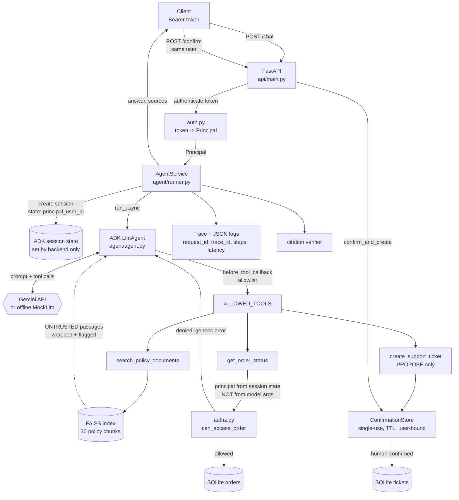

# Architecture

## Request flow

## Trust boundaries

| Boundary | Trusted? | Why |
|---|---|---|
| Bearer token -> `Principal` | Yes, backend | Resolved in `auth.py` before the agent runs |
| ADK session state `principal_user_id` | Yes | Written only by `AgentService._ensure_session` |
| Tool arguments (`order_id`, `query`, `issue`) | **No** | Model-chosen; validated with pydantic, then authorized |
| Model output | **No** | Can be wrong or manipulated; cannot widen privileges |
| Retrieved policy text | **No** | May contain injected instructions; wrapped, flagged, treated as data |
| Tool results | Yes (shape) | Uniform `{ok, data|error}`; internals never leaked |

## The key design decision

The model never supplies *who* it is acting for. `get_order_status(order_id, authenticated_user)` takes
`authenticated_user` from backend-controlled session state (`resolve_principal(tool_context)`), and
`can_access_order()` runs inside the tool on every call. A fully prompt-injected model can ask for any
order it likes; the backend still refuses. `tests/test_agent.py` proves this with a *compromised* model
that obeys the injected text.

## Module map

| Module | Responsibility |
|---|---|
| `config.py` | Env settings; API key is a `SecretStr` |
| `auth.py` / `authz.py` | Token -> Principal; pure authorization rules |
| `db.py` / `seed_data.py` | SQLite orders + tickets; synthetic data |
| `rag/` | Section chunker, embedders (Gemini / offline hash), FAISS index with relevance floor |
| `tools/registry.py` | Allowlist, principal resolution, `run_guarded` (validation, timeout, error mapping) |
| `tools/policy_search.py` | Retrieval tool; wraps passages as untrusted, flags injection-like text |
| `tools/order_status.py` | Authorized order lookup; deny == not-found (no enumeration) |
| `tools/ticket_tool.py` / `support_ticket.py` | Two-phase ticket: propose (model) -> confirm (human via API) |
| `agent/agent.py` | ADK `LlmAgent`, instructions, call-time allowlist guard |
| `agent/runner.py` | Per-turn orchestration, session scoping, trace, citation check |
| `agent/citations.py` | Flags cited policy sections that were not retrieved |
| `agent/mock_llm.py` | Deterministic offline model (+ "compromised" mode for security tests) |
| `observability/` | Trace objects/store; JSON logs with redaction |
| `api/` | FastAPI app, schemas |
